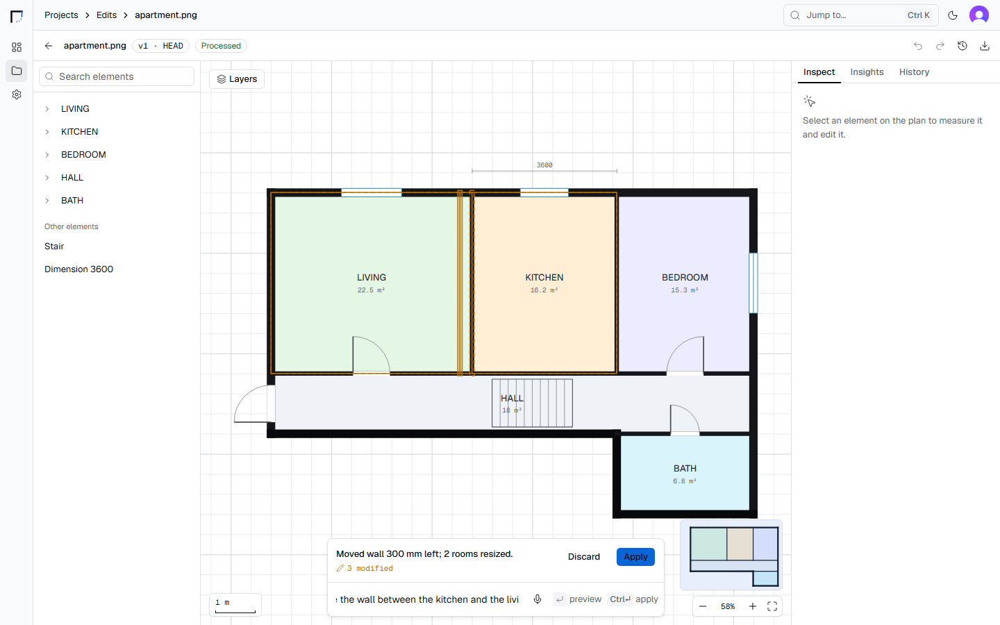
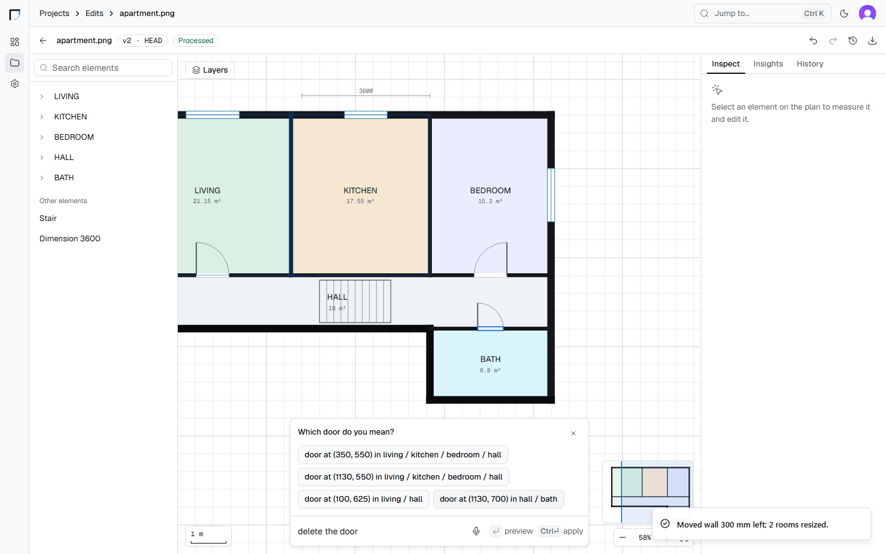
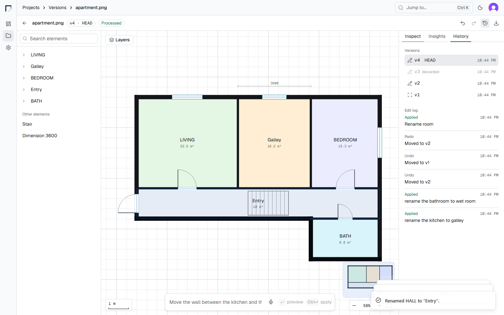

# AEC AI Platform

Upload a floor plan (PNG / JPG / PDF). Computer vision turns it into a **typed, versioned Building Model**: walls, rooms, doors, windows, columns, stairs and dimensions. Edit it by typing, speaking or clicking ("move the wall between the kitchen and the living room 300 mm left"). Language models only *interpret* text into a structured command; a **deterministic geometry engine** validates and applies every change, and each change becomes a new immutable version with undo/redo.

Default stack (free): Clerk (auth), Supabase (Postgres + Storage), OmniRoute (free LLMs), Tesseract, faster-whisper, local Docker. An optional AWS profile (S3, SQS, Lambda, ECR, ECS Fargate, Textract, Transcribe, Bedrock, SNS, CloudWatch) is switched on by env vars: see [docs/AWS_MIGRATION_PLAN.md](docs/AWS_MIGRATION_PLAN.md).

## Architecture

```
                        ┌──────────────────────────── Clerk (hosted auth, free tier) ───────────────────────────┐
                        │  sign-in UI, sessions, JWT (RS256, JWKS)                                              │
                        ▼                                                                                        │
┌──────────────────────────────┐   Bearer <Clerk session JWT>   ┌───────────────────────────────────────────┐   │
│ apps/web  (Next.js 16, :3000)│ ─────────────────────────────► │ services/api  (FastAPI, :8000)            │ ◄─┘ verifies JWT via JWKS
│ landing · dashboard · upload │                                │ the ONLY public backend & ONLY DB client   │
│ viewer · AI command panel    │ ◄───────────── JSON ────────── │ projects · uploads · jobs · versions ·     │
└──────────────────────────────┘                                │ undo/redo · audit · edit orchestration    │
                                                                │ + worker process (python -m app.worker)    │
                                                                └──────┬───────────────┬──────────────┬──────┘
                                              X-Internal-Token (HTTP)  │               │              │
                          ┌────────────────────────────────────────────┘               │              │
                          ▼                                                            ▼              ▼
          ┌───────────────────────────────┐  ┌───────────────────────────────┐  ┌──────────────────────────────┐
          │ services/vision  (:8001)      │  │ services/geometry  (:8002)    │  │ services/language  (:8003)   │
          │ image/PDF → FloorPlanModel    │  │ resolve · validate · apply    │  │ NL → command (rules + LLM)   │
          │ OpenCV · Tesseract · PyMuPDF  │  │ Shapely · deterministic       │  │ room-label classify          │
          │ stateless                     │  │ insights · plan brief         │  │ speech-to-text (whisper)     │
          └───────────────────────────────┘  │ stateless                     │  │ stateless                    │
                                             └───────────────────────────────┘  └──────────────┬───────────────┘
                                                                                               │ OpenAI-compatible
          ┌───────────────────────── Supabase (free tier, or local `supabase start`) ─┐        ▼
          │ Postgres 15+: users, projects, floorplans, jobs, model versions, edits    │  ┌────────────────────┐
          │ Storage: private buckets `floorplans`, `artifacts` (signed URLs)          │  │ OmniRoute (:20128) │
          └───────────────────────────────────────────────────────────────────────────┘  │ free-tier LLM pool │
                         ▲ only services/api talks to Supabase                            └────────────────────┘
```

| Path | What |
|---|---|
| `packages/contracts` | `aec_contracts`: every cross-boundary shape (Pydantic → JSON Schema → TypeScript), the room lexicon, fixtures |
| `services/{vision,geometry,language,api}` | FastAPI services, one uv project each |
| `apps/web` | Next.js 16 app (Tailwind 4, shadcn/ui, Clerk, TanStack Query, MSW) |
| `phases/` | The build plan: one prompt per Claude session, shared architecture, contracts, ownership, tooling |

## Screenshots

| Preview an edit before applying it | Ask instead of guessing | History with a discarded branch |
|---|---|---|
|  |  |  |

All screenshots in [apps/web/qa/p7](apps/web/qa/p7) come from the e2e suite running against the real stack.

## Tech

| Layer | Choice |
|---|---|
| Web | Next.js 16, React 19, Tailwind 4, shadcn/ui, TanStack Query, Clerk |
| API + worker | FastAPI, SQLAlchemy 2, Postgres job queue (`SKIP LOCKED`) |
| Vision | OpenCV, Tesseract, PyMuPDF |
| Geometry | Shapely 2, deterministic, Hypothesis-fuzzed |
| Language | Rules + OmniRoute (OpenAI-compatible, free LLMs), faster-whisper |
| Data | Supabase Postgres + private Storage (local `supabase start` or free tier) |
| Auth | Clerk (JWT via JWKS) |
| Contracts | Pydantic → JSON Schema → TypeScript |
| Tests | pytest, vitest, Playwright e2e (`e2e/`), GitHub Actions (`.github/workflows/ci.yml`) |

## Quick start (Windows PowerShell)

Prerequisites: Docker Desktop, Supabase CLI, Python 3.12 (`py -m uv`), Node 22+, a free Clerk application. Full setup and troubleshooting: [docs/RUNBOOK.md](docs/RUNBOOK.md).

```powershell
# 1. env files: copy every .env.example (apps/web/.env.example -> .env.local); add Clerk keys
# 2. database + storage
cd services/api; supabase start; supabase db reset; cd ../..   # put SERVICE_ROLE_KEY from `supabase status -o env` in .env
# 3. backend
docker compose up -d --build --wait vision geometry language api worker
# 4. web
cd apps/web; npm ci; npm run build; npx next start -p 3000      # http://localhost:3000
# 5. e2e (optional)
cd ../../e2e; npm ci; npx playwright install chromium; npx playwright test
```

Without a backend: `cd apps/web; $env:NEXT_PUBLIC_API_MOCKING="on"; npm run dev` runs the whole UI on MSW fixtures.

## Docs

[Architecture + decisions](docs/ARCHITECTURE.md) · [Runbook](docs/RUNBOOK.md) · [Feature status](docs/FEATURE_STATUS.md) · [Security](docs/SECURITY.md) · [Demo script](docs/DEMO_SCRIPT.md)

## Build plan

Start with [phases/README.md](phases/README.md). Status: [phases/STATUS.md](phases/STATUS.md). Shared docs: [ARCHITECTURE](phases/shared/ARCHITECTURE.md) · [CONTRACTS](phases/shared/CONTRACTS.md) · [OWNERSHIP](phases/shared/OWNERSHIP.md) · [TOOLING](phases/shared/TOOLING.md).
